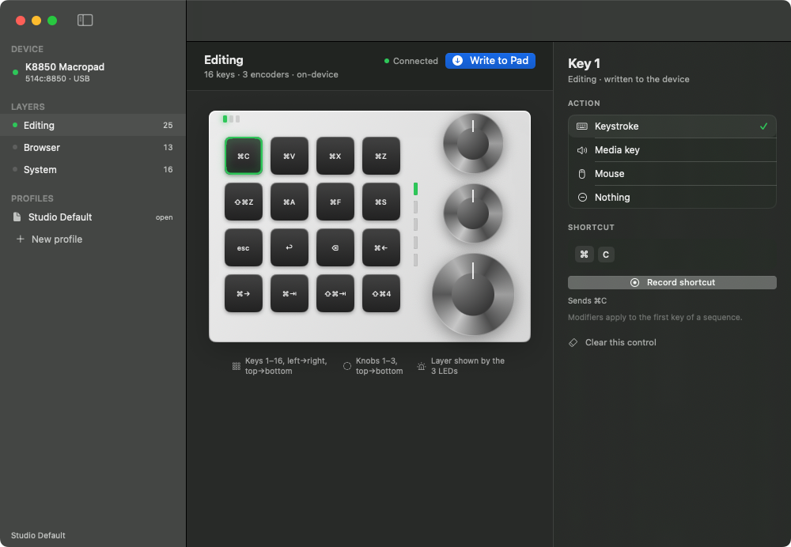

# MacroPad Manager

A native macOS app for programming small CH57x-based macro keypads — the unbranded
16-key / 3-encoder pads sold on AliExpress as "K8850", "MINI KeyBoard", "Customized
Mini Keyboard" and similar names.

The pad stores its keymap in its own flash, so whatever you write here keeps working
on every computer, over USB, Bluetooth **and** the 2.4 GHz dongle, with no software
running.



## What it does

- **Detects the pad automatically** over USB and shows which device is connected.
- **Three layers**, matching the hardware layer button and its three LEDs.
- **Every control editable**: 16 keys, plus turn-left / press / turn-right on each of
  the 3 encoders.
- **Actions**: keystrokes and sequences (up to 18 keys), media keys, mouse clicks and
  wheel, or nothing.
- **Record shortcuts by pressing them**, the way macOS does.
- **Profiles**: save, duplicate, delete, export and import as JSON.
- **Writes all three layers in one go** with a progress indicator.

## Requirements

- macOS 13 Ventura or later (universal: Apple Silicon and Intel).
- The keypad connected **by USB cable** while programming. Bluetooth and the
  2.4 GHz dongle deliberately expose no configuration channel — that is a hardware
  property, not a limitation of this app.

## Install

1. Open `MacroPadManager-1.0.0.dmg` and drag **MacroPad Manager** to Applications.
2. The build is **ad-hoc signed**, not notarized. The first launch must be
   **right-click → Open**, or Gatekeeper will refuse it.

   If macOS still complains, clear the quarantine flag:

   ```bash
   xattr -dr com.apple.quarantine "/Applications/MacroPad Manager.app"
   ```

3. Plug the pad in with its USB cable. The sidebar should show *K8850 Macropad* and a
   green dot.

## Using it

1. Pick a layer in the sidebar. Layer 1 is the leftmost LED on the pad.
2. Click a key or a knob part on the drawing.
3. Choose an action on the right. For a shortcut, hit **Record shortcut** and press
   the combination you want.
4. **Write to Pad**. The pad's own memory is updated; unplugging keeps the settings.

Key labels are drawn using **your active keyboard layout**, not QWERTY positions, so a
key that sends ⌘Z reads ⌘Z even on AZERTY.

### Layer switching is physical

The three layers are selected by the button on the pad, not by the app and not per
application. If you want Photoshop to get its own keys automatically, program the pad
to emit otherwise-unused chords (F13–F24 with modifiers) and map those per app in
BetterTouchTool or Karabiner-Elements.

## Supported devices

| Model | USB ID | Status |
|---|---|---|
| K8850 — 16 keys, 3 encoders | `514c:8850` (also `1189:8850`) | Supported, tested |
| CH57x 12-key, 2 knobs | `1189:8840`, `8842`, `514c:8851` | Declared, driver not implemented |

The app is written against a `DeviceDriver` protocol with a `DeviceModel` description
(rows, columns, knob count and geometry), so adding a pad means adding one model entry
and one encoder — not reshaping the UI. The 12-key family is next; it uses the `0xFE`
framing instead of `0xFD`.

## How it works

The pad is a composite HID device with two interfaces:

| Interface | Usage page | Purpose |
|---|---|---|
| 0 | `0xFF00`, usage `0x01` | Configuration channel — report ID 3, 64-byte reports |
| 1 | `0x01` | Ordinary keyboard / mouse / consumer input |

The configuration channel is written with `IOHIDDeviceSetReport` on interface 0. Key
bindings are encoded as:

```
03 FD <key id> <layer+1> <kind> 00 <count> [00 00 <hid usage>]*
03 FD FE FF      <- commit, after every binding
```

Key ids are 1–16 for buttons (row-major) and `17 + 3*n + action` for encoders, where
action is 0 = turn left, 1 = press, 2 = turn right.

Two details matter and are easy to get wrong:

- **Timing.** Reports must be spaced out. 4 ms loses bindings on this firmware;
  the app uses 50 ms and writes the whole set twice, because the pad cannot read its
  configuration back, so a dropped write is invisible.
- **The pad is not QMK.** Its vendor page is `0xFF00`, not VIA's `0xFF60`. VIA and
  QMK configurators will not work with it.

## Build from source

No Xcode required — Command Line Tools are enough.

```bash
./build.sh          # builds the universal .app and the .dmg into build/
```

`build.sh` compiles both architectures with `swiftc`, lipo-merges them, generates the
icon with Core Graphics, assembles the bundle, ad-hoc signs it and wraps it in a DMG
containing the app and an `/Applications` symlink.

### Signing properly

For a build without the Gatekeeper warning, sign with a Developer ID and notarize:

```bash
codesign --force --deep --options runtime --sign "Developer ID Application: …" "$APP"
xcrun notarytool submit "$DMG" --keychain-profile "notary" --wait
xcrun stapler staple "$DMG"
```

`build.sh` keeps the ad-hoc signature isolated in one step so this is a drop-in
replacement.

### Tests

```bash
swiftc -O -target x86_64-apple-macos13.0 -sdk "$(xcrun --show-sdk-path)" \
  -o /tmp/encodecheck Sources/Model.swift Sources/Driver.swift Sources/Store.swift Tools/main.swift
/tmp/encodecheck
```

Checks the encoder against byte streams captured from the vendor's own Windows
software. `Tools/write/main.swift` does the same against real hardware.

## Known limitations

- **No per-key RGB control.** The protocol encodes it, but this firmware variant's LED
  commands are not reversed yet, so the app does not touch lighting.
- **No read-back.** The pad cannot report its current keymap, so profiles live in
  `~/Library/Application Support/MacroPad Manager/` and are the source of truth.
- **macros are limited to 18 keys**, and on some boards modifiers only bind the first
  key of a sequence. That is a firmware constraint.
- Mouse *drag* is not offered; clicks and wheel are.

## License

MIT. Not affiliated with the hardware vendor. Reverse-engineering credits:
[kriomant/ch57x-keyboard-tool](https://github.com/kriomant/ch57x-keyboard-tool) (MIT),
which established the protocol family.
